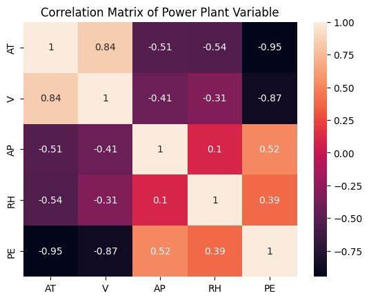
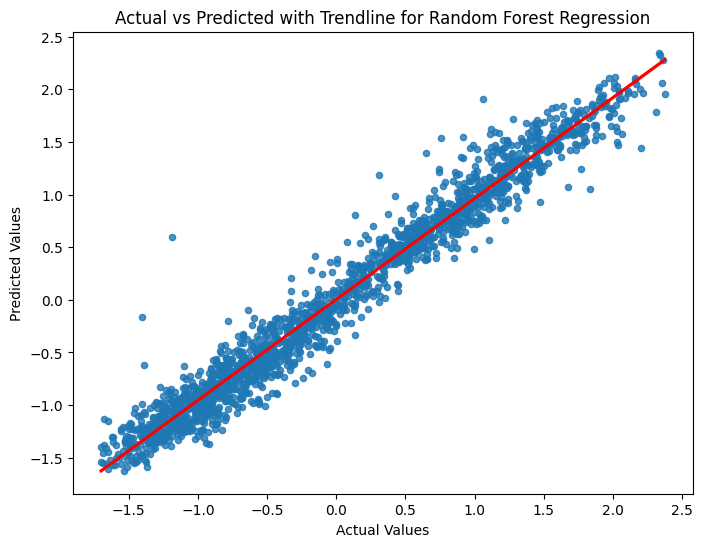
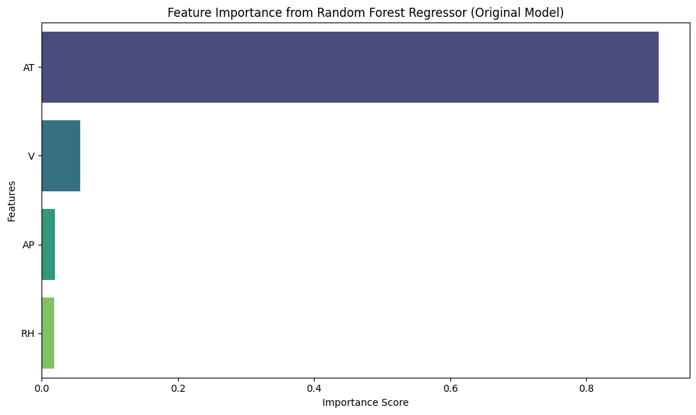

# Predicting Power Plant Energy Output with Machine Learning

**Supervised regression on 9,568 hours of real sensor data from a combined cycle power plant. Six models compared; the best one predicts hourly output to within about 3 MW (0.7% of average output).**

*Final project for MGMT 388 (Predictive Analytics), Purdue University · Team: Niharika Rai & Jared Richardson*


---

## TL;DR for reviewers

| | |
|---|---|
| **Problem** | Predict a power plant's net hourly electrical output (MW) from four ambient sensor readings |
| **Data** | [UCI Combined Cycle Power Plant dataset](https://archive.ics.uci.edu/dataset/294/combined+cycle+power+plant): 9,568 hourly records collected from 2006 to 2011, with no missing values |
| **Approach** | EDA, outlier analysis (IQR), feature standardization, 80/20 train/test split, six regression models, `RandomizedSearchCV` hyperparameter tuning, feature importance and ablation |
| **Best model** | Random Forest Regressor: **R² = 0.965**, RMSE ≈ **3.2 MW** on held-out test data |
| **Business value** | Accurate output forecasts support grid stability, lower operating costs, smarter energy trading, and safer integration of renewables |
| **Skills shown** | Python, pandas, scikit-learn, data visualization, model selection and evaluation, cross-validation, and explaining technical results to a non-technical audience |

---

## Why this problem matters

A base-load power plant sells its output in megawatt-hours, so **knowing in advance how much electricity it can produce at full load lets it bid accurately into energy markets and maximize profit**. Output from a combined cycle plant depends heavily on the weather: hot, humid air is less dense, which makes the gas turbines less efficient.

I chose this dataset because it ties machine learning to energy and sustainability. Better output forecasts help utilities:

1. **Keep the grid stable:** match supply to demand and reduce both blackouts and wasted surplus.
2. **Lower operating costs:** plan operations around output they can rely on.
3. **Bring in more renewables:** balance variable sources such as solar and wind with predictable conventional output.
4. **Increase profits:** bid and trade in electricity markets with better information.
5. **Cut emissions:** avoid running equipment unnecessarily. This supports UN Sustainable Development Goals 7 (Affordable & Clean Energy) and 13 (Climate Action).

---

## The data

| Feature | Description | Range |
|---|---|---|
| `AT` | Ambient Temperature (°C) | 1.81 to 37.11 |
| `V` | Exhaust Vacuum (cm Hg) | 25.36 to 81.56 |
| `AP` | Ambient Pressure (millibar) | 992.89 to 1033.30 |
| `RH` | Relative Humidity (%) | 25.56 to 100.16 |
| **`PE`** (target) | **Net hourly electrical energy output (MW)** | **420.26 to 495.76** (mean 454.4) |

Each row is an hourly average recorded while the plant ran at full load.

---

## Methodology

### 1. Data validation & exploratory data analysis
- Loaded the raw Excel data with **pandas** and profiled it with `info()` and `describe()`. All five columns are numeric, and the dataset has **0 missing values**.
- Drew **box plots** of every variable to look for outliers, and a **pairplot** to inspect distributions and pairwise relationships. `AT`, `V` and `PE` are bimodal, `AP` is roughly normal, and `RH` is left-skewed.
- Built a **correlation heatmap** and a **3D scatter plot** (AT × V × PE) to see how the features relate to output.

<p align="center">
  
</p>

**Finding:** Output falls sharply as temperature (r = −0.95) and exhaust vacuum (r = −0.87) rise. Pressure (r = +0.52) and humidity (r = +0.39) have weaker, positive relationships. `AT` and `V` are strongly correlated with each other (r = 0.84).

### 2. Preprocessing
- Wrote a reusable **`remove_outliers()` function** that applies the IQR (1.5 × IQR) rule column by column. It flags 98 of the 9,568 rows (about 1%) as outliers.
- **Standardized** all variables with `StandardScaler`, because the features are measured in very different units (°C, cm Hg, mbar, %).
- Split the data **80% train / 20% test** (`random_state=0`, so results are reproducible).

### 3. Model building & comparison
Trained six regression models in **scikit-learn** and evaluated each one on the held-out test set using **Mean Squared Error** and **R²**:

| Model | Test R² | Test MSE (standardized) | ≈ RMSE (MW)* |
|---|---:|---:|---:|
| Linear Regression | 0.9325 | 0.0678 | 4.4 |
| Polynomial Regression (degree 2) | 0.9422 | 0.0581 | 4.1 |
| Polynomial Regression (degree 4) | 0.9459 | 0.0543 | 4.0 |
| Polynomial Regression (degree 6) | 0.9492 | 0.0510 | 3.9 |
| Decision Tree Regressor | 0.9246 | 0.0757 | 4.7 |
| **Random Forest Regressor** | **0.9652** | **0.0349** | **3.2** |

<sub>*RMSE converted back to megawatts by multiplying the standardized RMSE by the standard deviation of PE (≈ 17.07 MW).</sub>

**Takeaways:**
- **Random Forest performed best.** It cut test error by about **48% compared with linear regression** (MSE 0.0349 vs. 0.0678).
- Higher-degree polynomial models improved steadily on the linear baseline, which shows the relationship has real non-linear structure.
- A single decision tree did *worse* than linear regression because it overfits. Averaging many trees (bagging) in a Random Forest fixes this, which is a textbook example of the bias–variance trade-off.

<p align="center">
  
</p>

### 4. Hyperparameter tuning
Tuned the Random Forest with **`RandomizedSearchCV`**: 20 parameter combinations × 5-fold cross-validation = 100 model fits, scored on R².

| Hyperparameter | Search range | Best value |
|---|---|---|
| `n_estimators` | 50 to 200 | 137 |
| `max_depth` | 10 to 50 | 31 |
| `min_samples_split` | 2 to 10 | 3 |
| `min_samples_leaf` | 1 to 5 | 1 |

The best configuration reached a **mean cross-validated R² of 0.959**, very close to the untuned model's test score. This shows that the default Random Forest was already well-calibrated for this data and that its performance holds up across different subsets of the data, not just one lucky split.

### 5. Model interpretation: feature importance & ablation

<p align="center">
  
</p>

- **Ambient Temperature accounts for about 90% of the model's feature importance.** Exhaust Vacuum is a distant second (about 6%).
- **Ablation test:** I retrained the Random Forest on `AT` alone. It still reached **R² = 0.89**, but error roughly tripled (MSE 0.110 vs. 0.035). So temperature drives most of the prediction, while the other three sensors supply the last few points of accuracy.
- **Business translation:** weather forecasts alone (especially temperature) can give the plant a reliable early estimate of output. Adding live plant telemetry (exhaust vacuum) gives the best accuracy.

---

## Results summary

- Built a model that explains **96.5% of the variance** in hourly power output.
- Typical prediction error is **about 3.2 MW on a mean output of about 454 MW (≈0.7%)**.
- Identified **ambient temperature** as the main driver of output, which gives operations teams a clear signal to act on.
- Presented the findings as a **12-slide deck for a business audience**, connecting model metrics to grid reliability, cost, profit, and sustainability outcomes.

---

## Repository structure

```
mgmt388/
├── Final_Project_MGMT_388.ipynb            # Full analysis: EDA → preprocessing → modeling → tuning → interpretation
├── MGMT 388 Final Project Presentation.pdf # 12-slide deck presenting results to a business audience
├── images/                                  # Key figures exported from the notebook
├── requirements.txt                         # Python dependencies
└── README.md
```

## How to run

1. Clone the repository and install the dependencies:
   ```bash
   git clone https://github.com/niharika-rai/mgmt388.git
   ```
   ```bash
   cd mgmt388
   ```
   ```bash
   pip install -r requirements.txt
   ```
2. Download the dataset from the [UCI Machine Learning Repository](https://archive.ics.uci.edu/dataset/294/combined+cycle+power+plant). Save the sheet as `Combined Cycle Power Plant.xlsx` in the project root; the notebook reads that filename.
3. Launch the notebook and run all cells:
   ```bash
   jupyter notebook Final_Project_MGMT_388.ipynb
   ```

---

## My contributions

This was a two-person team project. My work included:
- **Choosing the dataset** and framing the problem around energy markets and sustainability.
- **Data loading, validation and preprocessing:** missing-value checks, the IQR outlier-removal function, and feature standardization.
- **Building and evaluating the models:** the train/test split; the linear, polynomial (degrees 2, 4 and 6), decision tree and random forest regressors; MSE and R² evaluation; and actual-vs-predicted visualizations.
- **Turning the technical results into business insights** for the final presentation.

## Skills demonstrated

`Python` · `pandas` · `NumPy` · `scikit-learn` · `Matplotlib` · `Seaborn` · `Jupyter` · Exploratory Data Analysis · Data Cleaning · Feature Scaling · Regression Modeling · Ensemble Methods · Hyperparameter Tuning · Cross-Validation · Model Evaluation (MSE, R²) · Feature Importance · Data Visualization · Business Communication · Teamwork

---

## Acknowledgments

- Dataset: Pınar Tüfekci and Heysem Kaya, *Combined Cycle Power Plant* dataset, [UCI Machine Learning Repository](https://archive.ics.uci.edu/dataset/294/combined+cycle+power+plant).
- Course: MGMT 388, Daniels School of Business, Purdue University.
- Teammate: Jared Richardson.
